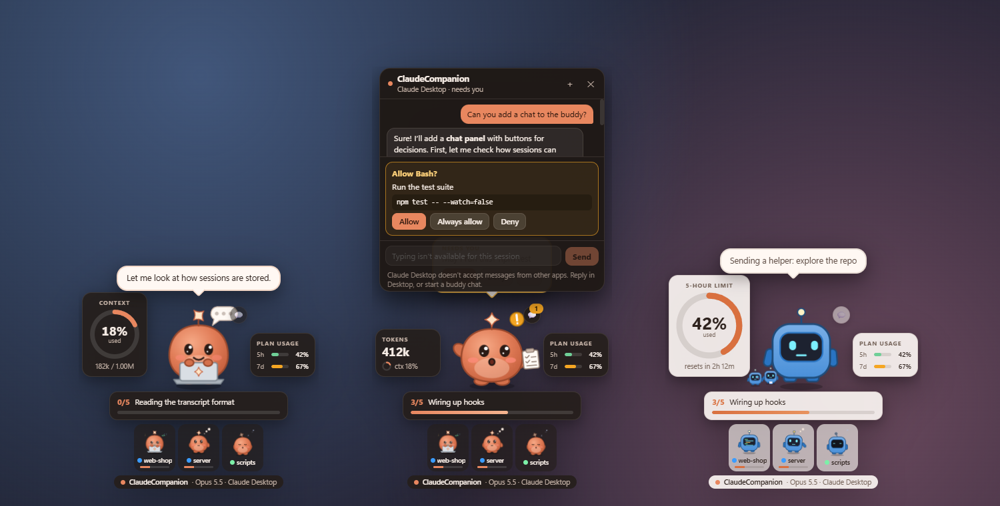
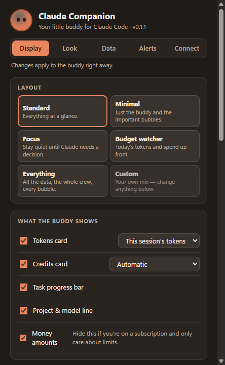

# Claude Companion

A little desktop buddy that keeps an eye on [Claude Code](https://code.claude.com) while you do something else. It shows what Claude is doing, the tokens it has used, how much of your plan or budget is left, how far along the task list is, and **whether Claude is waiting for you to decide something**. You can answer prompts and chat with Claude from the buddy itself.

> **Unofficial community project.** Claude Companion is not made, endorsed or supported by Anthropic. "Claude" and "Claude Code" are trademarks of Anthropic, PBC.



## Features

- **A buddy with moods.** It breathes and follows your cursor while idle, thinks, works with a prop for the current tool, hops and waves when it needs you, jumps when done, and dozes off. Click it to pet it, and drag it anywhere, on any screen.
- **It acts out the work.** It types on a laptop while Claude writes, codes while it edits, reads a book, sweeps a magnifier, watches a terminal, browses and ticks off a checklist, and now and then looks around, stretches or yawns. Turn each one off, or make them subtler or livelier.
- **Live status.** A speech bubble says what Claude is doing ("Editing store.js", "Run the test suite"), what's next on the task list, and a one-line summary when a turn ends.
- **Tokens and money.** Session tokens and context fill, an API-price cost estimate, totals for today and the last 5 hours, and your **claude.ai 5-hour and weekly limits** or a budget you set.
- **Tasks.** A progress bar for Claude's to-do list (`TodoWrite`, `TaskCreate` and `TaskUpdate`, and the Desktop app's plan).
- **Decisions.** Permission prompts, questions and plans show up with **Allow / Deny**, answer and **Approve** buttons, plus an optional notification.
- **Chat.** Read the conversation, type to Claude (where Claude Code allows it), or start a **buddy chat**, a Claude Code session that runs inside the buddy.
- **Several sessions at once.** Other sessions appear as mini buddies and subagents as tiny helper clones, from the terminal, VS Code or Claude Desktop.
- **Make it yours.** Layout presets, choose exactly what's shown and where each panel sits, a big ring for your context or plan limit, how many mini buddies and helpers to show, buddy, card and accent colours, card transparency and fading while idle, how much it moves, which projects to ignore, and more.
- **Your own character.** Pick a different buddy, or [make your own](docs/characters.md) from pictures or SVG and CSS, with an animation for every mood.
- **Local only.** Everything stays on your machine (see [Privacy and security](#privacy-and-security)).

## Install

Download the latest build from the **Releases** page:

| Platform | File |
| --- | --- |
| Windows | `Claude-Companion-Setup-<version>.exe` (installer) or `Claude-Companion-<version>-portable.exe` |
| macOS | `Claude-Companion-<version>-<arch>.dmg` |
| Linux | `Claude-Companion-<version>-x86_64.AppImage` |

The builds aren't code-signed yet. Windows SmartScreen may warn you: choose **More info → Run anyway**. On macOS, right-click the app and choose **Open** the first time.

Or run it from source (Node.js 22 or later):

```bash
npm install
```

```bash
npm start
```

## Getting started

1. **Start the app.** The buddy appears in the bottom-right corner, with an icon in the system tray. With no setup at all, it already follows your sessions by reading Claude Code's transcripts.
2. **Click ⚡ connect** in the buddy's footer, or go to Settings → Connect. This adds hooks to `~/.claude/settings.json`; it asks first and saves a backup. With hooks, the buddy reacts the moment Claude needs a decision and can answer prompts for you. Restart running Claude sessions afterwards.
3. **Optional:** turn on **Plan usage** in Settings → Connect to see your claude.ai limits (terminal sessions; needs Node.js on PATH).
4. **Right-click the buddy** for layout presets, what to show, activities, sessions to follow, size, screen and chat.
5. **Optional:** pick another character, or make your own, in Settings → Look → Character (see [Characters](#characters)).

## Chat and decisions

Click **💬** on the buddy to open the chat for the session it's following. When Claude is waiting on something, buttons appear:

| Claude is waiting on… | You get |
| --- | --- |
| A permission prompt | **Allow**, **Always allow** (when Claude Code offers a rule), **Deny**. Also right in the speech bubble |
| A question | One button per option, or tick several and press **Send answers** |
| A plan | **Approve plan**, or **Keep planning**, which sends what you typed as feedback |

What works depends on where the session runs:

| Session runs in | Answer prompts in the buddy | Type messages |
| --- | --- | --- |
| **Buddy chat** (**＋** in the chat) | Yes | Yes |
| **Terminal** started with the buddy's channel | Yes | Yes |
| **VS Code** | Yes. VS Code's own prompt stays open too, and whichever you answer first wins | The message opens in the right VS Code tab, ready to send |
| **Claude Desktop** | Yes. Desktop's own prompt stays open too | No. Desktop doesn't accept messages from other apps |
| Terminal without the channel | No | No |

- **Buddy chats** run Claude Code headlessly (`claude -p --input-format stream-json`) in a folder you pick, so everything happens in the buddy. The buddy uses the Claude Code it finds on PATH, from the native installer, or bundled with the VS Code extension (you can change this in Settings → Connect). That copy must be signed in: run `claude` and use `/login` once.
- **Terminal sessions** need to be started with the command shown in Settings → Connect:

  ```bash
  claude --mcp-config "<app data>/claude-companion/channel-mcp.json" --dangerously-load-development-channels server:claude-companion
  ```

  This loads [bridge/channel.js](bridge/channel.js), a small MCP server built on Claude Code's [channels](https://code.claude.com/docs/en/channels) (a research preview). It lets the buddy type into that session and relays its permission prompts. Claude Code shows a one-time developer-channel warning. Team and Enterprise organisations must allow channels.

## Make it yours

Changes apply right away. Quick toggles are in the right-click menu, and everything else is in **Settings**:



| Tab | What you can change |
| --- | --- |
| **Display** | Layout presets (Standard, Minimal, Focus, Budget watcher, Everything); each card on or off and what it measures; the tokens card as a big ring that fills up with the context window, the 5-hour or weekly limit or your budget; how many mini buddies (up to 8) and helpers (up to 6) to show, and where; where each panel sits (left, right, above or below the buddy, dragged into place); money amounts; how chatty the bubbles are, and for how long |
| **Look** | Character (built-in or your own) and a preview of each mood, name, colour (presets or any colour), movement (lively, calm, still), eyes following the pointer, activities (each one on or off, and how often), dark or light cards, card and accent colours, card opacity, fading while idle, size, screen, always-on-top |
| **Data** | How long a session counts as active, when the buddy sleeps, projects to ignore, spending budget |
| **Alerts** | Notifications, answering prompts from the buddy, start at login |
| **Connect** | Hooks, plan-usage status line, terminal chat command, Claude Code location |

### Characters

Three characters come built in: **Buddy**, **Blip**, a small robot, and **Ghost**, in pixel art. To make your own, pick the closest one in **Settings → Look → Character** and press **Make an editable copy**. Its folder opens, and the buddy updates every time you save a file there. A character is either a set of pictures (one per mood, sprite sheets or animated GIFs) or an SVG animated with CSS. The [character guide](docs/characters.md) walks through both, with every mood and tool you can animate.

Characters only draw: they can't run code, load anything from the internet, or draw outside the buddy's box. To add one someone shared, use **Add from folder…**.

## How it works

| Source | What it provides | Setup |
| --- | --- | --- |
| **Transcripts** in `~/.claude/projects` (or `$CLAUDE_CONFIG_DIR`) | Tokens, model, context, tasks, conversation, a best guess at status, subagents | None |
| **Hooks** → `127.0.0.1:47821` | Instant status, permission prompts, questions, errors, compaction. A synchronous `PermissionRequest` hook lets the buddy answer prompts | **⚡ connect** |
| **Status-line bridge** | claude.ai 5-hour, weekly and spend limits | Settings → Connect |
| **Channel bridge** | Typing into terminal sessions and relaying their prompts | Start the session with the channel command |

Event hooks run in the background (`async`) with `curl`, so they never slow Claude down, and they quietly do nothing when the app is closed. Claude Code only waits on the permission hook: the buddy holds it while you decide, but only for VS Code, Desktop and buddy-chat sessions (their own prompt stays open alongside it). Terminal prompts get an immediate "no opinion" reply. Costs are estimates at the list prices in [src/main/pricing.js](src/main/pricing.js); on a subscription, read them as "what this would cost on the API".

## Privacy and security

- Nothing leaves your machine. The app makes no network requests of its own; it reads local files and listens on `127.0.0.1` only. (Buddy chats are Claude Code sessions, so they talk to Anthropic like any other Claude Code session.)
- The local server rejects any request that carries a browser `Origin` header, so web pages can't send it events. Prompts can only be answered from the buddy's own window, never through the HTTP server.
- Hooks are added only when you ask, with a backup of your settings. They're tagged `claude-companion`, so removing them leaves your own hooks untouched.
- Answering a permission prompt in the buddy is the same as answering it in Claude Code. You can turn this off in Settings → Alerts.

See [SECURITY.md](SECURITY.md) to report a vulnerability.

## Platform notes

Developed and tested on **Windows 11**. macOS and Linux builds are produced by CI but have had less hands-on testing; reports are welcome. On Linux, transparent areas of the widget may not let clicks through to the windows underneath (an Electron limitation).

## Development

| Command | What it does |
| --- | --- |
| `npm start` | Run the app |
| `npm run dev` | Run with hook events and a state summary logged to the console |
| `npm run demo` | Cycle through every mood with made-up data (`npx electron . --demo=chat` shows one scene) |
| `npm test` | Unit and integration tests (Node's built-in test runner) |
| `npm run pack` | Build an unpacked app into `dist/` |
| `npm run dist` | Build installers for the current platform |

There's no build step: the main process is CommonJS, and the renderer uses plain scripts and CSS. See [CONTRIBUTING.md](CONTRIBUTING.md) for the project layout and dev flags.

## Contributing

Issues and pull requests are welcome. Please read [CONTRIBUTING.md](CONTRIBUTING.md) and the [Code of Conduct](CODE_OF_CONDUCT.md).

## License

[MIT](LICENSE)
